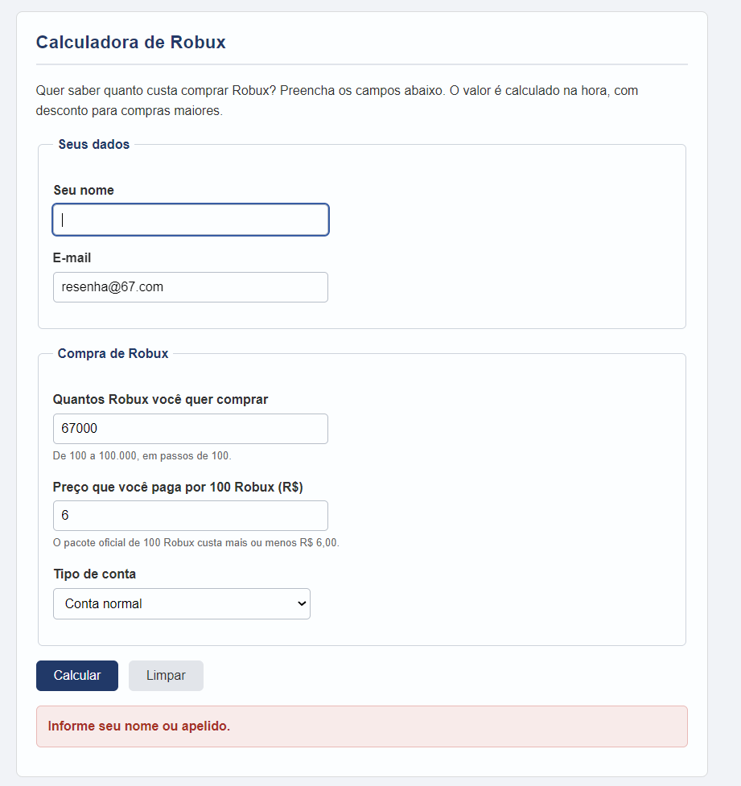
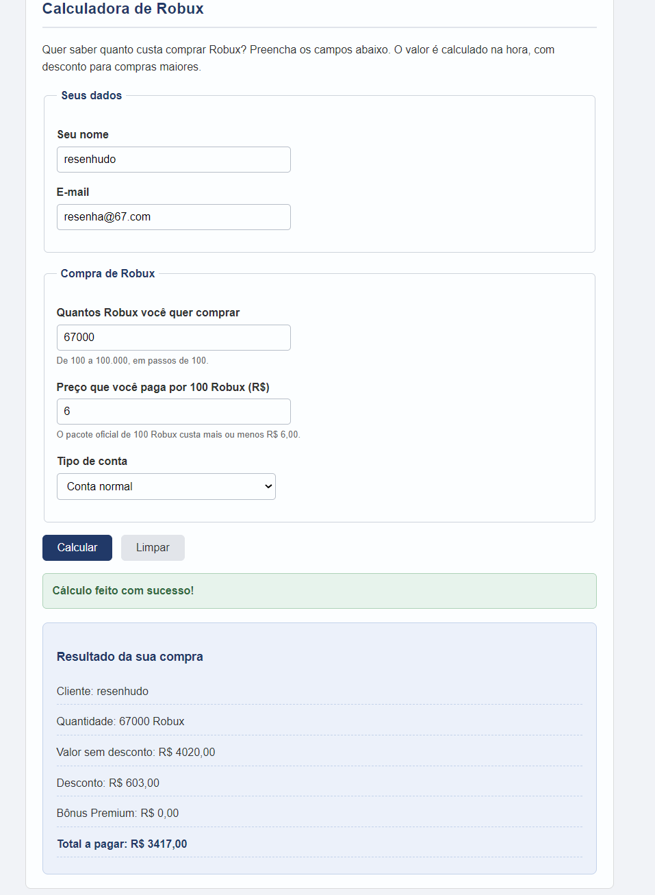

# Avaliação Prática -- Programação de Aplicativos
• Estudante: Julian Gabriel

• Turma: DS 2025/1 M3

• Unidade Curricular: Programação de Aplicativos

---

## E1 -- Repositório
• Endereço do repositório público:

https://github.com/julianschmith/avaliacao-pratica

---

## E2 -- Página no computador

Figura 1: Página inicial exibida no navegador em tela do computador

---

## E3 -- Página em largura de celular

Figura 2: A mesma página na tela do celular

---

## E4 -- Formulário recusando envio invalido

Figura 3: Envio com o campo de nome vazio, recusado com mensagem de orientação ao usuário

---

## E4 -- Formulário aceitando envio válido

Figura 4: Envio com dados corretos, exibindo o total calculado de R$ 3417,00